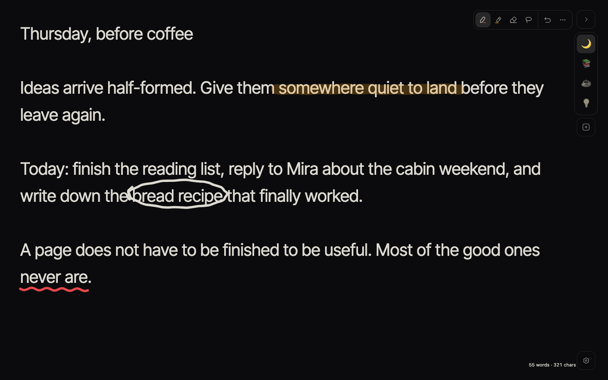
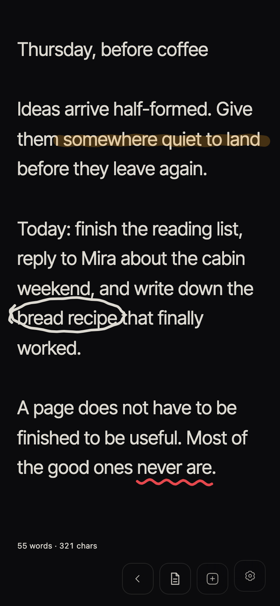
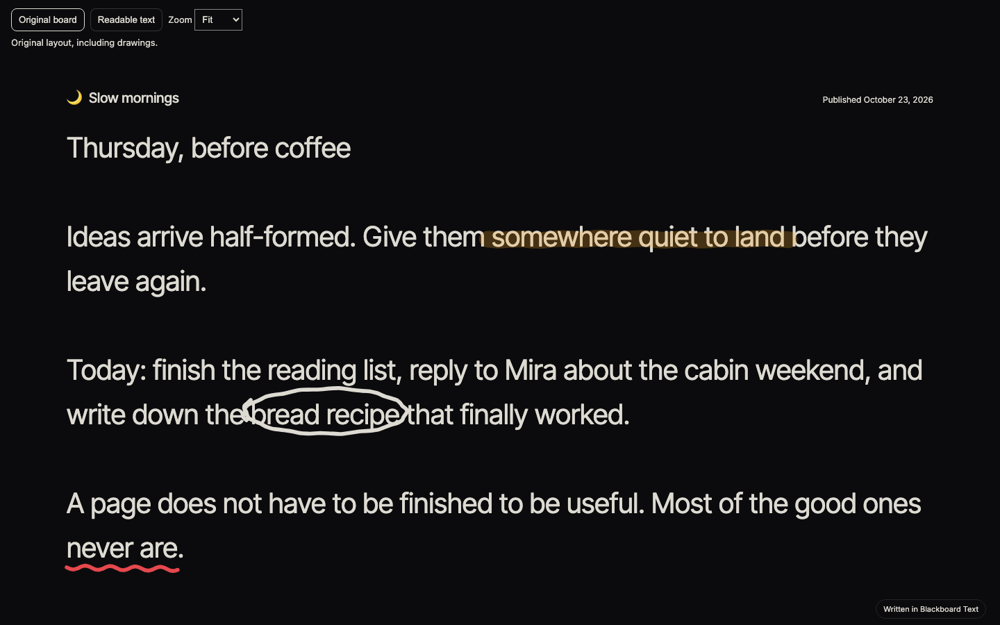

<div align="center">


# Blackboard Text

**A quiet, local-first place to think.**

Write, sketch and keep pages of notes in your own browser. No account, no
analytics, no sync. Nothing leaves the browser unless you create a short link,
which uploads only the copy you share.

[Open the app](https://piwqust.github.io/blackboard/) ·
[Install](#get-started) ·
[Releases](https://github.com/Piwqust/blackboard/releases) ·
[Privacy](#privacy)

[](https://github.com/Piwqust/blackboard/releases/latest)
[](./LICENSE)
[](https://github.com/Piwqust/blackboard/actions/workflows/validate.yml)

</div>



## Features

- **Write.** Plain, comfortable text with autosave, word count and Tab
  indentation. Choose the font (Inter Tight, Inter, Board Grotesk or a system
  font), size, line height, letter spacing and width, one of nine themes or
  your own colours. The interface is in English or Russian.
- **Draw.** Pen (with optional pressure), marker, eraser and select, right on
  top of the text. Strokes stay where you drew them when the window resizes,
  and can be attached to words so they follow your edits.
- **Pages.** Emoji tabs with optional names that you can reorder, pin and
  preview on hover. Search names and text with Ctrl/⌘ K. Export a page as
  TXT, Markdown, PNG or PDF.
- **Share.** Send a read-only copy of one page as a full link (nothing
  uploaded) or a short link (stored online, can be disabled). See
  [Sharing](#sharing).
- **Your data.** Everything lives in this browser. Portable backups, recovery
  snapshots and per-page history protect against mistakes. See
  [Backups](#backups-recovery-snapshots-and-page-history).

<p align="center">
  
  &nbsp;
  
</p>

## Get started

### Web app (recommended)

1. Open **https://piwqust.github.io/blackboard/** in Chrome or Edge.
2. To install it, choose **Install** in the address bar or the browser menu.
3. After the first visit it works offline. When a new version is deployed, a
   small **Reload** prompt appears; your latest change is saved before the
   page reloads.

### Personal browser extension

The extension is the same app with its own storage, opened from the toolbar.
It does not update itself.

1. Download `blackboard-text-extension-<version>.zip` from
   [Releases](https://github.com/Piwqust/blackboard/releases) (attached from
   2.4.2 on) and unzip it, or build it yourself (see
   [Development](#development)) and use `dist/edge-extension/`.
2. Open `chrome://extensions` or `edge://extensions`, turn on **Developer
   mode**, choose **Load unpacked** and select the folder.
3. To update, replace the folder's contents and press **Reload** on the
   extensions page.

Release zips are built with short links connected. A local build without
`SHORT_LINKS_API_URL` offers full links only.

### Moving notes between them

The web app and the extension never share storage. Export a backup in one
(**Settings → Your data → Export backup**) and import it in the other, choosing
whether to replace the workspace or add the pages.

## Sharing

Open **Settings → Page actions → Share a copy…** (or **Share a copy…** in a
page's settings). Anyone with the link can read the copy, and later edits to
your page do not change it.

| | Full link | Short link |
| --- | --- | --- |
| Where the copy lives | Inside the link, after the `#`. Browsers never send that part to a server. | Uploaded to the short-link service (a Cloudflare Worker with D1). The service operator can read it. |
| Length | Grows with the page; the dialog shows it. Under about 4 KB works anywhere. | About 60 characters, whatever the page size. |
| Revocable | No. There is no copy anywhere to delete. | Yes, from **Shared links from this browser**. Copies recipients already saved cannot be recalled. |
| Opens offline | Yes, once the app has been opened in that browser. | No, it needs the service. |

Both open in the read-only reader, which shows the page as written, adds a
**Readable text** mode and zoom, and strips scripts and remote resources.

The keys that disable short links stay in the browser that created them and
are not in workspace backups. **Settings → Your data → Link management
backup…** exports them as a passphrase-encrypted file; import it in another
browser to manage your links from there.

## Backups, recovery snapshots and page history

All three are in **Settings**:

- **Export backup / Import backup** (Your data) write and read a portable
  `.blackboard.json` file with every page, drawing and setting. Import checks
  the file first and saves a recovery snapshot before changing anything.
- **Recovery snapshots** (Your data) are taken automatically before an import,
  a page delete, clearing drawings or a restore. The seven most recent are
  kept; restore the latest or browse them and recover single pages.
- **Page history** (Page actions) keeps up to 25 earlier versions of each page,
  100 in total and 10 MB, captured at most every 30 seconds. Recovering a
  version creates a new page. Page history is not part of a backup.

Clearing site data, uninstalling the extension or deleting the browser profile
removes your notes. Export a backup first.

## Privacy

Pages, drawings, settings, snapshots and page history are stored in IndexedDB
for this browser profile. There are no accounts, analytics or automatic sync;
the web app fetches only its own files from GitHub Pages. A full link never
reaches a server. A short link uploads that one copy to the short-link
service, which keeps it until you disable it; Cloudflare processes IP addresses
for rate limiting, and the app does not store them.

Details: [docs/privacy.md](./docs/privacy.md) and the in-app
[privacy page](https://piwqust.github.io/blackboard/privacy.html).

## Keyboard shortcuts

| Shortcut | Action |
| --- | --- |
| `Ctrl`/`⌘` `K` | Find a page |
| `Alt` `Shift` `N` | New page |
| `Ctrl`/`⌘` `Z` | Undo text, or the last drawing change while drawing |
| `Ctrl`/`⌘` `Shift` `Z`, `Ctrl`/`⌘` `Y` | Redo text, or drawing while drawing |
| `Tab` / `Shift` `Tab` | Indent / outdent in the note |
| `B` / `E` | Pen / eraser, when the cursor is not in text |
| `Alt` `Shift` `B` / `E` | Pen / eraser, also while typing |
| Hold `Shift` while drawing | Straight line |
| Hold `Alt` while drawing | Temporary eraser |
| `Delete` / `Backspace` | Delete the selected stroke (select tool) |
| `Shift` + mouse wheel over the note | Text size |
| `↑` `↓` `←` `→`, `Home`, `End` on page tabs | Move between tabs; `Alt` + arrow reorders |
| `Esc` | Close a dialog, panel or picker; otherwise leave drawing mode |

## Browser support and limits

- Built for Chrome and Edge on desktop. Automated tests run Chromium at desktop
  and phone widths for both the web app and the extension.
- Editing needs Web Locks (Chrome or Edge over HTTPS or on localhost). A second
  tab with the same workspace, or a browser without Web Locks, opens
  read-only: you can switch pages, export a backup and share, but not edit.
- PDF export is an image of the board, so its text cannot be selected or
  searched; use TXT or Markdown for that. PNG export is capped at 8 million
  pixels and 8192 px per side; tall pages become a multipage PDF.
- Short links hold copies up to 900,000 encoded characters; larger pages can
  use a full link or a file export. Backups up to 50 MB can be imported.
- Physical pens and touch devices, and screen readers such as VoiceOver, have
  not been verified by hand.

## Upgrading from the 1.x unpacked extension

Extension storage belongs to the extension's ID, so keep the same folder:

1. Replace the files in your original unpacked folder with a 2.x extension
   build and press **Reload** on the extensions page.
2. Open Blackboard Text. It copies the old workspace into the new storage and
   leaves the original records in place.
3. Export a backup from **Settings → Your data** if you want to move the notes
   to the web app.

A newly loaded extension from a different folder cannot see the old data.

## What's new

See [CHANGELOG.md](./CHANGELOG.md) and
[Releases](https://github.com/Piwqust/blackboard/releases).

## Development

Requires Node 22.13 or later.

```bash
npm ci
npm run verify                    # lint, version check, unit tests, build, check dist/
npx playwright install chromium   # once
npm run test:browser              # Playwright against dist/pwa and dist/edge-extension
npm run test:shares               # short-link API and browser tests on a local Worker and D1
```

```text
editor.html/.js/.css   the editor
read.html, s/          reader for shared copies and the short-link route
src/core/              storage, schema, backups, sharing and drawing logic
src/ui/                interface modules
backend/short-links/   Cloudflare Worker and D1 migrations
scripts/               build, checks, test server, screenshots
tests/                 unit tests; tests/browser holds the Playwright suite
dist/                  generated: pwa/ (GitHub Pages) and edge-extension/
```

- `SHORT_LINKS_API_URL` is the public address of the short-link service, read
  at build time. Without it, the share dialog explains that short links are not
  connected and offers full links. CI uses the repository variable of the same
  name. For a local Worker, run `npm run shares:dev` and build with
  `SHORT_LINKS_API_URL=http://127.0.0.1:8787`.
- New files under `src/` are picked up by the build automatically; add a new
  top-level page to `staticFiles` in `scripts/build.mjs`. The offline file list
  in `pwa-sw.js` is generated, and `scripts/verify-dist.mjs` fails if anything
  is missing from it.
- Refresh the README screenshots with
  `npm run build && node scripts/readme-screenshots.mjs`.

## Releasing

One-time setup: set **Pages** to deploy from **GitHub Actions** and add the
`SHORT_LINKS_API_URL` repository variable.

1. Bump the version in `package.json`, `manifest.json` and `APP_VERSION` in
   `editor.js`. `npm run lint` fails if they differ.
2. Add a `## [x.y.z] - YYYY-MM-DD` section to `CHANGELOG.md`. It becomes the
   release notes, and the release fails without it.
3. If the published note format changed, deploy the Worker first
   (`npm run shares:deploy`) and check it with
   `node scripts/verify-live-short-link.mjs`. The Worker validates that format.
4. Commit and push, then tag: `git tag vx.y.z && git push origin vx.y.z`.

The **Release PWA** workflow checks that the tag matches `package.json`, runs
the full verification, browser and short-link tests, builds with
`SHORT_LINKS_API_URL` and deploys `dist/pwa` to GitHub Pages. It then creates
the GitHub Release with `blackboard-text-extension-x.y.z.zip`, its `.sha256`
checksum and the changelog section, marked Latest only for the highest version.

## Self-hosting short links

Short links are optional. To run your own service, follow
[docs/short-links/README.md](./docs/short-links/README.md).

## License and fonts

The code is available under the [MIT License](./LICENSE). Inter and Inter
Tight are bundled under the SIL Open Font License 1.1
([`fonts/Inter-OFL.txt`](./fonts/Inter-OFL.txt)). BoardGrotesque Sans, shown in
the app as Board Grotesk, is a proprietary asset of the project owner, supplied
with permission; it is not covered by the MIT or OFL licenses.
